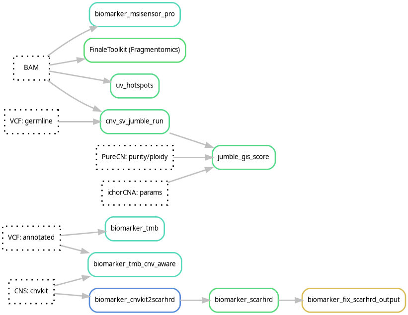

# Biomarkers
See the [biomarkers hydra-genetics module](https://hydra-genetics-biomarker.readthedocs.io/en/latest/) documentation for more details on the softwares for the respective biomarkers. Default hydra-genetics settings/resources are used if no configuration is specified.

 
{: style="height:50%;width:50%"}

## Pipeline output files:

* `results/dna/{sample}_{type}/tmb/{sample}_{type}.TMB.txt`
* `results/dna/{sample}_{type}/additional_files/biomarker/{sample}_{type}.tmb_cnv_aware.TMB.txt`
* `results/dna/{sample}_{type}/msi/{sample}_{type}.msisensor_pro.score.tsv`
* `results/dna/{sample}_{type}/biomarker/{sample}_{type}.pathology_purecn.scarhrd_cnvkit_score.txt`
* `results/dna/{sample}_{type}/biomarker/{sample}_{type}.pathology_purecn.predicted_gis.txt`
* `results/dna/{sample}_{type}/additional_files/biomarker/{sample}_{type}.jumble_gis.csv`
* `results/dna/{sample}_{type}/additional_files/biomarker/{sample}_{type}.gis.png`
* `results/dna/{sample}_{type}/additional_files/biomarker/{sample}_{type}.uv_hotspots.{call,summary,sites,positions}.tsv` (GMS-Solid only)

## Tumor mutational burden (TMB)
TMB is a measure of the frequency of somatic mutations and is usually measured as mutations per megabase. The size of design of the exons is approximately 1.55Mb. However, by validating the TMB for GMS560 against Foundation One and TSO500 TMB the effective design size is adjusted to 1.19Mb. This is based on the slope (0.84) of the correlation between TSO500 data and the number of variants in the TMB analysis. The TMB is calculated using the in-house script **[tmb.py](https://github.com/hydra-genetics/biomarker/blob/develop/workflow/scripts/tmb.py)** ([rule](https://github.com/hydra-genetics/biomarker/blob/develop/workflow/rules/tmb.smk)) which counts the number of nsSNVs and divide by the adjusted design size. Variants must fulfill the following criteria to be counted:

### Configuration
**Software settings**

| **Options** | **Value** | **Description** |
|-|-|-|
| af_lower_limit | 0.05 | Minimum 5% allele frequency |
| af_upper_limit | 0.95 | Maximum 95% allele frequency |
| af_germline_lower_limit | 0.47 | Filter out probable germline SNPs with allele frequency between 47%-53% |
| af_germline_upper_limit | 0.53 | Filter out probable germline SNPs with allele frequency between 47%-53% |
| artifacts | " " | Do not use artifact panel of normal |
| background_panel | " " | Do not use background panel of normal |
| db1000g_limit | 0.0001 | Germline filter of 0.01% population frequency
| dp_limit | 100 | Minimum read depth of 100 |
| gnomad_limit | 0.0001 | Germline filter of 0.01% population frequency ||
| nssnv_tmb_correction | 0.84 | (Number of variants - nr_avg_germline_snvs) * correction factor (correction factor = 1 / adjusted design size) |
| nr_avg_germline_snvs | 2.0 | Correction based on the average number of germline variants passing all filters |
| vd_limit | 10 | Minimum 10 observations of variant allele |

The result is the TMB calculated using nsSNVs. However, the variants passing all filters are also provided.

### Result file

* `results/dna/{sample}_{type}/tmb/{sample}_{type}.TMB.txt`

## Tumor mutational burden, copy-number aware (TMB CNV-aware)
**[tmb_cnv_aware.py](https://github.com/hydra-genetics/biomarker/blob/develop/workflow/scripts/tmb_cnv_aware.py)** ([rule](https://github.com/hydra-genetics/biomarker/blob/develop/workflow/rules/tmb.smk)) is a parallel, comparison TMB calculation. It runs alongside the standard TMB above (same input variants, same design-size correction) but replaces the fixed 47%-53% germline allele-frequency window with a copy-number/BAF-aware check: it looks up the local CNVkit segment (`cnv_sv/cnvkit_call/{sample}_{type}.pathology_purecn.loh.cns`) and, where CNVkit fitted a reliable segment BAF, excludes variants clustering near that BAF or its mirror (`1 - BAF`) instead of only near 50% — catching germline SNPs sitting away from 50% AF inside copy-number-altered regions (LOH, gain, loss) that the fixed-window check would miscount as somatic. Falls back to the standard fixed window wherever CNVkit could not fit a segment BAF (common in this targeted panel). It also adds two read-quality gates not present in the standard TMB: `PMEAN` (mean read position) and `NM` (mean mismatches per read), filtering out the same class of recurrent low-quality/misalignment artifacts identified in the SNV hard filters.

This is not yet a replacement for the standard TMB result above — it is produced as an additional file for comparison.

### Configuration
**Software settings**

| **Options** | **Value** | **Description** |
|-|-|-|
| af_lower_limit | 0.05 | Minimum 5% allele frequency |
| af_upper_limit | 0.95 | Maximum 95% allele frequency |
| af_germline_lower_limit | 0.47 | Fallback fixed germline window, used where no segment BAF is available |
| af_germline_upper_limit | 0.53 | Fallback fixed germline window, used where no segment BAF is available |
| cn_baf_tolerance | 0.05 | Tolerance around the segment BAF (or `1 - BAF`) for the copy-number-aware germline check |
| pmean_limit | 15 | Minimum mean read position (VarDict `PMEAN`) |
| nm_limit | 4 | Maximum mean mismatches per read (VarDict `NM`) |
| artifacts | " " | Do not use artifact panel of normal |
| background_panel | " " | Do not use background panel of normal |
| db1000g_limit | 0.0001 | Germline filter of 0.01% population frequency |
| dp_limit | 100 | Minimum read depth of 100 |
| gnomad_limit | 0.0001 | Germline filter of 0.01% population frequency |
| nssnv_tmb_correction | 0.84 | (Number of variants - nr_avg_germline_snvs) * correction factor (correction factor = 1 / adjusted design size) |
| nr_avg_germline_snvs | 2.0 | Correction based on the average number of germline variants passing all filters |
| vd_limit | 10 | Minimum 10 observations of variant allele |

### Result file

* `results/dna/{sample}_{type}/additional_files/biomarker/{sample}_{type}.tmb_cnv_aware.TMB.txt`

## Microsatellite instability (MSI)
To determine MSS or MSI status of the samples the percentage of sites that have microsatellite instability are calculated using **[MSIsensor-pro](https://github.com/xjtu-omics/msisensor-pro)** v1.1.a. When more than 10% of the sites are instable the sample is determined to have MSI status. The program uses a panel of normal to determine the normal level of instability in the used sites.

### Configuration
**Reference**

* [Panel of normal](references.md#msisensor_pro_pon) for MSIsensor-pro (see [references](references.md) on how the PoN was created)

### Result file

* `results/dna/{sample}_{type}/msi/{sample}_{type}.msisensor_pro.score.tsv`

## Homologous recombination deficiency (HRD) - in development
**OBS! The Homologous recombination deficiency score is still under development**  
A homologous recombination deficiency score is calculated using **[scarHRD](https://github.com/sztup/scarHRD)** v20200825 using cnvkit segmentation files as input. The cnvkit panel of normal for HRD is created from a design file where the extra CNV-probes were removed as coverage in these regions tended to be more affected in low quality samples. The segmentation is sensitive to the estimated purity. Therefore, a score based on both the pathology and purecn estimated tumor content is reported. The cutoff for HRD is still to be determined but is somewhere around 50 which is slightly higher than the Myriad HRD score cutoff of 42.

### Jumble GIS (HRD) score
**[Jumble](https://github.com/UPP-ClinicalGenomics/Jumble)** also provides a Genomic Instability Score (GIS) which is a measure of HRD. The score is calculated based on various genomic features including LOH, TAI, and LST. The rule `jumble_gis_score` extracts the predicted GIS score from Jumble's GIS table, which is indexed by the tumor DNA fraction.

The tumor DNA fraction only equals the tumor cell content (purity) at ploidy 2. It is calculated as purity × ploidy / (purity × ploidy + 2 × (1 − purity)), using each method's own purity and ploidy, since the two are estimated together. A higher DNA fraction gives a lower GIS.

The result file has one row per method (pathology, PureCN and ichorCNA) with purity, ploidy, DNA fraction, the GIS at ploidy 2 (purity used as DNA fraction) and the GIS at the DNA fraction. Pathology has no ploidy, so only its ploidy 2 GIS is given. An estimate of 0 or missing is shown as `-`. The first row is the best estimate, which is currently PureCN's purity and ploidy. Its `manual_review` column is `yes` when the best estimate, ichorCNA (DNA fraction) and pathology (ploidy 2) give GIS values on both sides of the HRD cutoff, any of them is within the review margin of the cutoff, or the PureCN and ichorCNA DNA fractions differ by more than `dna_fraction_review_margin`. The cutoff (`hrd_cutoff`, default 42), margin (`review_margin`, default 5) and `dna_fraction_review_margin` (default 0.1) are set under `jumble_gis_score` in the config.

The predicted GIS depends on the tumor content, and a higher assumed TC gives a lower GIS. The result file therefore lists the GIS at the reported TC and at each available TC estimate (pathology, PureCN and ichorCNA; an estimate of 0 or missing is shown as `-`). The `manual_review` column on the reported row is `yes` when the estimates give GIS values on both sides of the HRD cutoff, or any of them is within the review margin of the cutoff, so the HRD call depends on which TC is used. The cutoff (`hrd_cutoff`, default 42) and margin (`review_margin`, default 5) are set under `jumble_gis_score` in the config.

#### Result files

* `results/dna/{sample}_{type}/biomarker/{sample}_{type}.{method}.predicted_gis.txt`
* `results/dna/{sample}_{type}/additional_files/biomarker/{sample}_{type}.jumble_gis.csv`
* `results/dna/{sample}_{type}/additional_files/biomarker/{sample}_{type}.gis.png`

### Configuration

**Reference for cnvkit**

* [Panel of normals](references.md#normal_reference_hrd) created by cnvkit with extra CNV-probes removed (see [references](references.md) on how the PoN was created)

**Software settings**

| **Options** | **Value** | **Description** |
|-|-|-|
| reference_name | "grch37" | Reference genome |
| seqz | FALSE | Do not use seqz |

### Result files

* `results/dna/{sample}_{type}/biomarker/{sample}_{type}.pathology_purecn.scarhrd_cnvkit_score.txt`

## UV hotspot mutations - experimental
UV light joins neighbouring pyrimidines into dimers, and a cytosine in a dimer mutates C>T (CC>TT when both
cytosines are hit). In front of ETS-bound `TTCCG` promoter elements, dimers form far more often than elsewhere
in the genome, so the `YY` dipyrimidine in `YYTTCCG` is one of the most recurrently mutated positions in
melanoma ([Elliott et al. 2018](https://doi.org/10.1371/journal.pgen.1007849)). These mutations are passengers,
and the number of mutated hotspots tracks the UV mutation load of the tumour.

The GMS-Solid panel captures 100 such sites: the 150 most recurrently mutated in melanoma, minus those where the
main hotspot overlaps a known SNP (dbSNP 155). For each site the in-house script
**[uv_hotspots.py](https://github.com/genomic-medicine-sweden/Twist_Solid/blob/develop/workflow/scripts/uv_hotspots.py)**
counts fragments at:

* **Y1/Y2**: the cytosines of the `YY` dipyrimidine, the main hotspot (164 positions)
* **C5**: the cytosine after `TT`, a weaker hotspot that has not been checked against dbSNP, reported separately (100 positions)
* **flank**: all other C/G positions within 15 bp, the in-sample background for C>T errors. Positions that look
  germline in the sample are left out, and CpG positions are reported separately as they are noisier

Bases are counted per fragment on the C (pyrimidine) strand, so G>A on the reference is reported as C>T.
Overlapping mates count once when they agree and are dropped when they disagree. C>T fragments are split by read
orientation, as FFPE deamination artefacts tend to appear in one orientation only. At CC sites, fragments with
C>T at both positions (CC>TT) are counted.

The analysis is experimental and its results are collected for evaluation, not reported. Only C>T is used for
hits and rates, C>A and C>G are reported per position. In the GMS-Solid validation samples (no skin tumours) no
site was hit, the hotspot C>T rate was about 2 x 10-4 per fragment, and the hotspot rate was about
0.75 times the non-CpG flank rate. Samples with UV exposure are expected to have hits and a higher hotspot vs flank
ratio, but this has not yet been tested on UV-positive samples.

The output is only produced when `uv_hotspots: positions` is set, which is done in
`config.data.hg38.GMS-Solid.yaml`.

### Normal background
There is no per-position normal background (as used for SNV filtering) in this analysis. It could be added later as
a reference file with the C>T level of each hotspot position in normal samples, so that a hit must also be above
the normal level. It may not be needed:

* **The in-sample flank is the background.** Hotspot and flank C>T rates follow each other closely between
  samples (Spearman 0.88 in the validation samples), so most of the noise is a property of the sample, which the
  hotspot vs flank ratio corrects for without any reference file. This works the same way for FFPE and ctDNA.
* **The noise is flat across positions.** In the validation normals, no hotspot position was recurrently noisy
  and no position had more than 4 C>T fragments, so a per-position background would contain about 0 everywhere
  and add little to the `min_alt`/`min_vaf` thresholds.
* **It would need a good base.** Eight validation normals give mostly 0-1 C>T fragments per position, and
  UMI-collapsed ctDNA data would need its own background.

If recurrently noisy positions show up in the collected data, a background can be built from the collected
results of many runs; non-UV clinical samples serve as background too.

### UV call and cut-offs (provisional)
The call file gives an overall UV call with the supporting numbers, in the form `metric`, `value`, `cutoff`,
`result`. The cut-offs are **provisional**: they are set from the GMS-Solid validation samples, none of them UV
exposed, so they are known to give no false positives there (all 32 samples are called `no`) but their sensitivity
is unknown. They should be recalibrated when UV-positive samples (melanoma, cutaneous SCC) are available.

| **Metric** | **Cut-off** | **Result** | **Basis** |
|-|-|-|-|
| UV_call | from `sites_covered`, `sites_hit` and `low_frequency_ratio` | `yes`, `possible`, `no` or `not evaluable` | `yes` needs clonal hits; an elevated `low_frequency_ratio` alone gives at most `possible` |
| sites_covered | >= 80 of 100 sites with >= 100 fragments at every hotspot position | below gives `not evaluable` | all validation samples had 98-100 |
| sites_hit | >= 3 sites gives `yes`, 1-2 `possible`, 0 `no`. A hit is >= 3 C>T fragments and >= 2% C>T at Y1 or Y2; possible germline hits are not counted | | no hits in any validation sample. 2% catches a clonal heterozygous mutation from about 4% tumour content. A single hit can come from a very high TMB without UV, which is why 1-2 hits need review |
| sites_possible_germline | hits with >= 35% C>T, not counted as hits | `review` | tumour-only samples; such a hit may be a SNP |
| dnv_CCTT_fragments | >= 1 | `supports UV` | CC>TT in one fragment is very specific to UV; 0-1 in the validation samples |
| hotspot_alt_F1R2_fraction | outside 0.1-0.9 with >= 10 C>T fragments | `possible FFPE artefact` | FFPE deamination tends to sit in one read orientation; 0.3-0.75 in the validation samples |
| low_frequency_ratio, low_frequency_p | C>T rate at Y1/Y2 positions without a hit against the non-CpG flank rate: ratio >= 1.5 and one-sided binomial p < 0.01 | `elevated` raises `no` to `possible` | ratio 0.46-1.27 and lowest p 0.08 in the validation samples. Hit positions are left out so clonal hits do not drive it; it picks up hotspot mutations below the 2% hit threshold, e.g. at low tumour content. It may also reflect UV-damaged normal skin in the sample rather than the tumour, so it never gives `yes` on its own |
| manual_review | | `yes` with the reasons | a `possible` call (from hits or from an elevated ratio), possible germline hits, or an orientation bias together with hits |

### Configuration

**Software settings**

| **Options** | **Default** | **Description** |
|-|-|-|
| positions | (not set) | UV hotspot position table, the analysis only runs when set |
| min_alt | 3 | Minimum C>T fragments for a hit |
| min_vaf | 0.02 | Minimum C>T fraction for a hit |
| uv_sites_hit | 3 | Sites with a somatic hit for UV_call `yes` |
| possible_sites_hit | 1 | Sites with a somatic hit for UV_call `possible` |
| elevated_ratio | 1.5 | `low_frequency_ratio` for `elevated` |
| elevated_p | 0.01 | Binomial p-value for `elevated` |

The other thresholds are fixed in the script: base quality >= 30, mapping quality >= 20, >= 100 fragments for a
covered site and a hit, possible germline at >= 35% C>T, flank positions left out at >= 10% non-reference, and the
call's coverage (80 sites) and orientation (0.1-0.9, >= 10 fragments) checks.

### Result files

* `results/dna/{sample}_{type}/additional_files/biomarker/{sample}_{type}.uv_hotspots.call.tsv`: UV call with
  metrics, cut-offs and a manual review flag, meant for the general report
* `results/dna/{sample}_{type}/additional_files/biomarker/{sample}_{type}.uv_hotspots.summary.tsv`: one row
  per sample with sites hit, CC>TT fragments, hotspot, C5 and flank C>T counts and rates, and the hotspot vs flank
  ratio
* `results/dna/{sample}_{type}/additional_files/biomarker/{sample}_{type}.uv_hotspots.sites.tsv`: one row per site
* `results/dna/{sample}_{type}/additional_files/biomarker/{sample}_{type}.uv_hotspots.positions.tsv`: one row per
  position with fragment counts, read orientation of C>T fragments and hit/flank flags

## Fragmentomics
Fragmentomics analysis is performed using **[FinaleToolkit](https://github.com/epigen/FinaleToolkit)**. It calculates various metrics related to cell-free DNA fragmentation patterns, which can be used as biomarkers.

### Result files

* `results/dna/{sample}_{type}/fragmentomics/{sample}_{type}.end-motifs.tsv`
* `results/dna/{sample}_{type}/fragmentomics/{sample}_{type}.mds.txt`
* `results/dna/{sample}_{type}/fragmentomics/{sample}_{type}.interval-end-motifs.tsv`
* `results/dna/{sample}_{type}/fragmentomics/{sample}_{type}.interval-mds.txt`
* `results/dna/{sample}_{type}/fragmentomics/{sample}_{type}.frag-length-bins.tsv`
* `results/dna/{sample}_{type}/fragmentomics/{sample}_{type}.fragment_length_score.txt`

## ctDNA Fraction Estimation
ctDNA fraction estimation is performed using **[Fragle](https://github.com/skandlab/FRAGLE)**. It calculates the ctDNA fraction based on fragment length proportions and machine learning models.

### Configuration
**Software settings**

| **Options** | **Value** | **Description** |
|-------------|-----------|-----------------|
| design_bed | " " | Target BED file containing captured regions |
| genome_build| "hg38" or "hg19" | The reference genome build |
| model | "T" or "R" | panel or WGS |

### Result files

* `results/dna/{sample}_{type}/cnv/{sample}_{type}.ctDNA_fraction.fragle.csv`

## ctDNA Fraction Estimation (SNV based, copy-number corrected)
This method estimates the ctDNA fraction from a single high-confidence somatic driver mutation:
identifying the highest-VAF variant surviving quality/clinical-relevance filtering, then converting
its allele frequency to a tumor fraction. Both a raw estimate (TC = 2 * AF, assuming a plain diploid
heterozygous locus) and a copy-number-adjusted estimate are reported. The adjusted estimate looks up
the local copy number at the variant's position from CNVkit's segment file (`.cns`) and corrects for
gains, losses, and LOH, assuming the mutant allele is the one preferentially amplified on a gain and
the retained allele(s) are mutant on a loss/LOH. Sample sex is inferred per-sample from CNVkit's
bin-level ratios (`.cnr`, comparing chrX to autosomal log2) so that chrX variants in inferred males
are treated as hemizygous (normal copy number 1) rather than diploid.

In addition to the driver-based estimate, the best variant found under the same QC filtering but
*without* the clinical-relevance ("driver") gate and the consequence-type exclusion (so synonymous/UTR/
non-coding-exon variants are eligible too) is also evaluated - a passenger mutation, less trustworthy
individually (more likely subclonal, no functional/recurrence support) but still carrying the same
VAF-based purity signal. Its raw/adjusted TC is reported as `raw_tc_all`/`adjusted_tc_all`
only when it adds information: no driver-passing variant was found, or its raw TC exceeds the driver's
- otherwise these columns read `NA`. The best passenger candidate is always recorded in
`ctDNA_fraction_info.tsv` (labelled `source=passenger`, alongside the driver candidates labelled
`source=driver`) for manual review regardless of whether it was promoted.

### Configuration
**Software settings**

The SNV filtering is highly configurable to ensure only high-quality somatic variants are used for estimation:

| **Group** | **Options** | **Default** | **Description** |
|-----------|-------------|-------------|-----------------|
| **SNV** | max_af | 0.4 | Filter out likely germline (high AF) |
| | max_gnomad_af | 0.0002 | Max population frequency |
| | min_mq | 40 | Min Mapping Quality |
| | min_qual | 40 | Min Variant Quality |
| | callers | ["vardict"] | Required callers |
| | chip_genes | ["DNMT3A", "TET2", "ASXL1", "PPM1D"] | Genes excluded as likely CHIP |

### Result files

* `results/dna/{sample}_{type}/cnv/{sample}_{type}.ctDNA_fraction.tsv`
* `results/dna/{sample}_{type}/cnv/{sample}_{type}.ctDNA_fraction_info.tsv`
